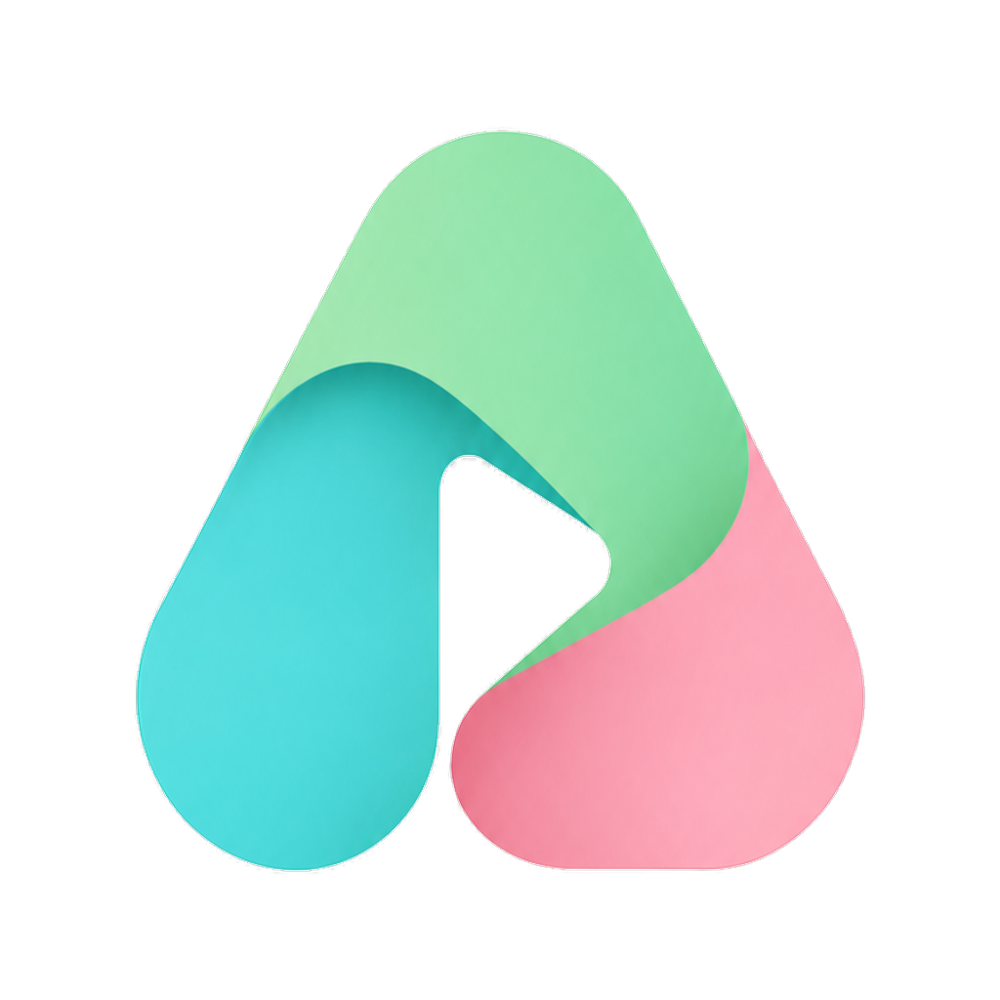

<div align="center">



# Anthology for Vessel

**Vessel için İlk Resmi & Referans Native TypeScript Eklenti Deposu**

[](https://github.com/falsisdev/Vessel)
[](#-eklenti-kataloğu-33-eklenti)
[](#-reference-architecture--vessel-sdk-guide-english)
[](LICENSE)

[Hızlı Kurulum](#-30-saniyede-hızlı-kurulum) • [Canlı TV & Ayarlar](#-canlı-tv-ve-eklenti-ayarları) • [33 Eklenti Kataloğu](#-eklenti-kataloğu-33-eklenti) • [Developer SDK Guide (EN)](#-reference-architecture--vessel-sdk-guide-english)

</div>

---

**Anthology for Vessel**, Türk kullanıcılara yönelik Canlı TV, Film, Dizi, Türk TV Ağları, Yeşilçam ve Anime arşivini **Vessel**'ın kendi native TypeScript eklenti mimarisi (`vessel.*` SDK + `oxc` + `rquickjs` sandbox) için baştan aşağı tip güvenli biçimde sunan bağımsız eklenti deposudur.

> [!NOTE]
> Vessel, Stremio/Nuvio/CloudStream eklentilerini uyumluluk katmanıyla çalıştırabilse de bu depo **yalnızca Vessel native TypeScript eklenti standardı** kullanılarak geliştirilmiştir. Statik Stremio JSON şişkinliği içermez; hem son kullanıcılar için yüksek hızlı akışlar sunar hem de Vessel için ilk resmi **referans eklenti mimarisi** örneğini oluşturur.

---

## ⚡ 30 Saniyede Hızlı Kurulum

Vessel uygulaması içinde **Extensions (Eklentiler) → Add Repository** bölümünden aşağıdaki yöntemlerden birini kullanın:

| Yöntem | Adres / Komut | Açıklama |
|---|---|---|
| **GitHub Shorthand (Önerilen)** | `gh:falsisdev/anthology-vessel` | Vessel doğrudan `main` dalındaki `repo.json` indeksini çözer |
| **Tek Tık Deep Link** | `vessel://install?src=gh:falsisdev/anthology-vessel` | Tarayıcıdan doğrudan Vessel ekleme penceresini açar |
| **Doğrudan Ham `repo.json`** | `https://raw.githubusercontent.com/falsisdev/anthology-vessel/main/repo.json` | Manuel veya alternatif mirror kurulumu için |
| **Yerel Geliştirici Modu** | **Extensions → Inspect Source** → klasör seçin | Tek bir eklenti (`plugins/anthology-tv`) veya tüm repo dizini |

---

## 📡 Canlı TV ve Eklenti Ayarları

`anthology-tv`, Anthology'nin 7 ayrı canlı kategorisini (**Canlı Spor, Ulusal Kanallar, Canlı Haber, Sinema Kanalları, Belgesel & Çocuk, Müzik & Eğlence, Yerel & Diğer**) tek bir birleşik Vessel eklentisinde toplar ve **388 kanal** için temiz kanal adı, kategori ile yayın dili bilgisini sunar.

### Ayarlanabilir Eklenti Parametreleri (`settingsSchema`)
- **`anthology-tv` (Canlı TV):**
  - `anthologyLiveUrl`: Özel Anthology-Live proxy sunucu adresi (varsayılan: `https://anthology-live.duckdns.org`)
  - `anthologyLiveUsername`: Kullanıcı adı
  - `anthologyLivePassword`: Gizli parola alanı (`secret`)
  - `preferredSportSource`: Tercih edilen canlı maç kaynağı (otomatik veya belirli kaynak)
- **`anthology-plus` (`Anthology+` Birleşik TMDB Motoru):**
  - **Kaynak Anahtarları (`toggle`):** `enableVixolity`, `enableGoVod`, `enableVidlink`, `enableHdFilmDelisi`, `enableSinemaCx`, `enableAnimecix`, `enableSeicode`, `enableSonAnime` (her kaynak tek dokunuşla açılıp kapatılabilir)
  - `anthologyLiveUrl` & `vidlinkMirror`: Özel VOD / Vidlink sunucu adresleri
- **Site tabanlı VOD eklentileri:**
  - `mirrorUrl`: Alan adı engellenen siteler için özel güncel mirror URL girişi

---

## 🧩 Eklenti Kataloğu (33 Eklenti)

### 📡 Canlı TV & Birleşik TMDB Motoru (2 Çekirdek Eklenti)

| Eklenti ID | Ad | Özellikler | Sağladığı Akışlar |
|---|---|---|---|
| `anthology-tv` | Anthology Canlı TV | `live_tv`, `search` | 7 kategori M3U, Anthology-Live çoklu kaynak, 5 canlı spor çözücüsü, resmi CDN & YouTube Innertube canlı yedekleri |
| `anthology-plus` | Anthology+ | `vod`, `search`, `subtitles` | TMDB Film/Dizi/Anime kataloğu + toggle ile yönetilen 8 kesin eşleşen kaynak (Vixolity Çift Ses, Go VOD, Vidlink, HDFilmDelisi, SinemaCX, AnimeciX, SeiCode, SonAnime) |

### 🎬 Film & Karma VOD (9 Eklenti)

| Eklenti ID | Ad | Türler | Çözücü / Kaynak |
|---|---|---|---|
| `hdfilmcehennemi` | HDFilmCehennemi | Film, Dizi | CloseLoad obfuscated JS (`vessel.unpack` + `vessel.evalWithEnv`) HLS + VTT |
| `filmmodu` | FilmModu | Film | ImgsAPI çoklu kaynak + segment probe + Pilavyer fallback |
| `hdfilmizle` | HDFilmİzle | Film, Dizi | JSON parts + WP AJAX + `SetPlay` / `FastPlay` + Vidrame / Vidmoxy |
| `setfilmizle` | SetFilmİzle | Film, Dizi | `STF_AJAX` + `SPG.cerceve` XOR çözücü (`FastPlay` 1080p HLS + VTT) |
| `hdfilmdelisi` | HDFilmDelisi | Film, Dizi | `/api/films` JSON + Vixolity çoklu ses/altyazı HLS + Vidmody embed |
| `kultfilmler` | KültFilmler | Film | Vidpapi ve VidMoly adaptif HLS |
| `webteizle` | Webteİzle | Film | VidMoly, OK.ru, Filemoon, Dzen çoklu ses |
| `liderfilmizle` | LiderFilm | Film, Dizi | `liderfilm.cc` VOD + `ag2m4` (Katkı: `@metemel`) |
| `sinemacx` | SinemaCX | Film | Base64 `data-vsrc` + `player.filmizle.in` + Vixolity fallback |

### 📺 Dizi & Türk TV Ağları (14 Eklenti)

| Eklenti ID | Ad | Türler | Çözücü / Kaynak |
|---|---|---|---|
| `anthology-diziler` | Anthology Dizi | Dizi | NOW, Show TV, Kanal D, Star, ATV, TRT 1 resmi dizi yayınları |
| `ddizibox` | DDiziBox | Dizi, Film, Anime | Pilavyer Player 1080p HLS + çift ses + WebVTT |
| `ddizi` | DDizi | Dizi | Ciner, Yandex, Dailymotion ve YouTube Innertube fallback |
| `dizibak` | DiziBak | Dizi | `player.dizibak.net` doğrudan HLS |
| `diziboxizle` | DiziBoxİzle | Dizi | WP JSON kategoriler + OK.ru / VidMoly |
| `dizimom` | DiziMom | Dizi, Film | Pilavyer Player + gömülü oynatıcılar |
| `dizipod` | DiziPod | Dizi, Film | `get_episode_player` + `vessel.unpack` |
| `diziwatch` | DiziWatch | Dizi, Anime | AnizmPlayer, OK.ru, Sibnet |
| `diziyou` | DiziYou | Dizi | `storage.diziyou.one` Dublaj/Altyazılı HLS + VTT |
| `puhutv` | PuhuTV | Dizi, Film | PuhuTV `__NEXT_DATA__` + DYG `mncdn` HLS + VTT |
| `trdiziizle` | TR Dizi İzle | Dizi | Site oynatıcısı + YouTube Innertube resmi bölüm yedeği |
| `tvdiziler` | TvDiziler | Dizi | Twitter Amplify, Ciner, Streambox & YouTube Innertube |
| `yabancidizi` | YabancıDizi | Dizi, Film | VidMoly çoklu gömülü akışlar |
| `youtube-dizifilm` | YouTube Dizi & Film | Dizi, Film | Resmi üretici kanalları & Yeşilçam (Katkı: `@metemel`) |

### ⛩️ Anime (8 Eklenti — `type: "series" | "movie"`, `isAnime: true`)

| Eklenti ID | Ad | Türler | Çözücü / Kaynak |
|---|---|---|---|
| `animecix` | AnimeciX | Anime | `secure/*` API (`x-e-h`) + TauVideo MP4 |
| `anizium` | Anizium | Anime | `Cf-Control` XOR token, 4K/2160p & 1080p MP4 + VTT + AniZip/Kitsu/AniList |
| `anizm` | Anizm | Anime | V3 `/arama-onerileri` + AnizmPlayer/OK.ru/Sibnet + DiziWatch fallback |
| `animom` | AniMOM | Anime | HDPlayer, Sibnet, YourUpload + DiziWatch/AnizmPlayer fallback |
| `animeprax` | AnimePraX | Anime | Takım kaynakları (Sibnet, OK.ru, Dailymotion) + DiziWatch fallback |
| `asyaanimeleri` | AsyaAnimeleri | Anime | Base64 ayna seçenekleri + AsyaPlayer HLS, Sibnet, OK.ru, Mail.ru, Rumble, VidMoly |
| `seicode` | SeiCode | Anime | `next.seicode.net` API + TauVideo, OK.ru, Sibnet, VidMoly, MP4Upload |
| `sonanime` | SonAnime | Anime | `api.sonanime.com` + `video.konununuzmani.com` 1080p–360p doğrudan MP4 |

---

## 🛠️ Reference Architecture & Vessel SDK Guide (English)

`anthology-vessel` is designed as a clean reference implementation for developers building native TypeScript repositories for **Vessel** (`crates/vessel-plugin-rt`).

### Repository & Bundle Layout

```text
anthology-vessel/
├── repo.json                 # Generated RepoIndex listing all 33 plugin directories
├── config.json               # Central remote configuration (mirror URLs, API overrides)
├── data/canli.m3u            # Source M3U playlist converted into plugins/anthology-tv/channels-data.ts
├── types/vessel.d.ts         # Exact TypeScript declarations aligned with vessel-domain & vessel-plugin-rt
├── core/                     # Shared runtime utilities (http, config, text, quality, tmdb, live-tv, exact-tmdb-sources, ...)
├── extractors/               # Reusable host extractors (closeload, okru, pilavyer, vidmoly, vixolity, ...)
├── plugins/<id>/             # Canonical self-contained plugin folders synced in-place by scripts/sync-plugins.ts
│   ├── manifest.json         # Vessel schemaVersion: 1 manifest (capabilities, domains, settingsSchema toggles)
│   ├── index.ts              # Plugin entry exporting definePlugin(...)
│   └── shared/...            # Only the core/extractor files imported by this plugin (no ../ escapes)
└── scripts/
    ├── sync-plugins.ts       # Traces static imports from core/ & extractors/ & builds plugins/<id>/shared + repo.json
    ├── validate-repo.ts      # Validates schemas, domain policies, and oxc erasableSyntaxOnly compliance
    ├── pack-plugins.ts       # Builds dist/<id>.plugin.vessel ZIP packages on demand
    ├── vessel-mock.ts        # Faithful Node host mock implementing "vessel" SDK + DomainPolicy
    ├── test-unit.ts          # Offline unit assertions for text, quality, M3U, toggles, extractors
    └── test-smoke.ts         # Live end-to-end smoke runner across all 33 plugins
```

### Native Plugin Contract (`manifest.json` + `definePlugin`)

Every Vessel native plugin package under `plugins/<id>/` contains:

1. **`manifest.json`** (`schemaVersion: 1`):
   - `id`, `name`, `version`, `entry` (`"index.ts"`)
   - `capabilities`: subset of `["vod", "live_tv", "search", "subtitles", "skip_segments"]`
   - `contentTypes`: `["movie", "series", "anime", "live"]` (note: `MediaSummary.type` and `MediaDetail.type` remain strictly `"movie" | "series" | "live"`, with `isAnime: true` set on anime items)
   - `domains`: explicit allowlist of every host the plugin queries (`allowAnyHttps` stays `false`)
   - `settingsSchema`: declarative settings UI (`text`, `secret`, `select`, `toggle`, `number`) read via `storage.getSetting(key)`

2. **`index.ts`** exporting `definePlugin(...)` from `"vessel"`:
   - `getHomeFeed(cursor?)` → `{ sections: HomeSection[] }`
   - `search(query, filters, page)` → `{ items: MediaSummary[], hasMore: boolean }`
   - `getDetails(nativeId)` → `MediaDetail` (with `seasons`, `episodes`, optional `externalIds`)
   - `getSeasonEpisodes?(nativeId, season)` → lazy episode loading
   - `getStreams(streamId)` → `{ streams: StreamCandidate[] }`

3. **Vessel Sandbox Rules (`oxc` + `rquickjs`):**
   - Author in **erasable TypeScript** (`erasableSyntaxOnly: true`, `isolatedModules: true`, `verbatimModuleSyntax: true`): avoid `enum`, `namespace`, parameter properties, and CommonJS `require`.
   - Use **native SDK modules only**: `import { definePlugin, http, html, crypto, storage, unpack, evalWithEnv } from "vessel"`. Never bundle Node built-ins or `cheerio`/`axios`.
   - Never swallow `[VesselDomainBlockedError]` inside `try/catch`; rethrow it so Vessel can prompt the user to grant access to newly discovered mirror domains.
   - Do not import `.json` files inside QuickJS ESM graphs; `scripts/sync-plugins.ts` converts `data/canli.m3u` into a clean `.ts` module (`channels-data.ts`).

### Local Development & Verification

```bash
npm install
npm test                  # Strict tsc --noEmit + sync + manifest/AST validation + unit assertions
npm run test:smoke        # Live smoke tests across all 33 plugins
npm run test:smoke -- anthology-tv anizium
npm run pack              # Optional .plugin.vessel archives in dist/
```

---

## 🤝 Ekosistem, Katkıda Bulunanlar & Yasal Uyarı

- **Geliştirici & Bakım:** [falsisdev](https://github.com/falsisdev)
- **Katkıda Bulunanlar:** `Mustafa Esat Temel (metemel)` (`liderfilmizle`, `youtube-dizifilm`), `Wiojelt`, `iptv-org`
- **İlgili Projeler:**
  - [Vessel](https://github.com/falsisdev/Vessel) — Rust + QuickJS + libmpv medya uygulaması
  - [Anthology](https://github.com/falsisdev/anthology) — Nuvio & Stremio klasik JS eklenti deposu
  - [Anthology Live](https://github.com/falsisdev/anthology-live) — Canlı yayın & spor proxy motoru
  - [Anthology DAV](https://github.com/falsisdev/anthology-dav) — Stremio / WebDAV köprüsü

> **Yasal Uyarı:** `anthology-vessel`, hiçbir video veya medya dosyasını kendi sunucularında barındırmaz. Tüm eklentiler yalnızca halka açık üçüncü taraf web kaynaklarından teknik akış çözümleri üreten açık kaynak kodlu TypeScript adaptörleridir.
